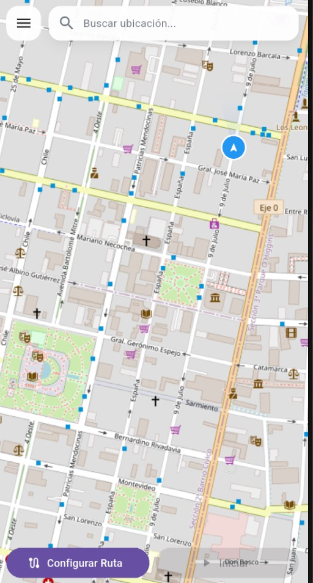
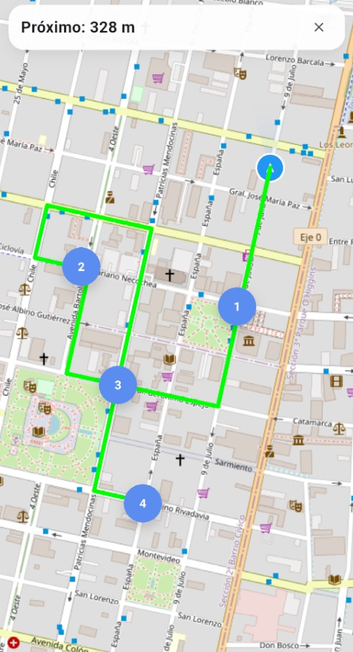
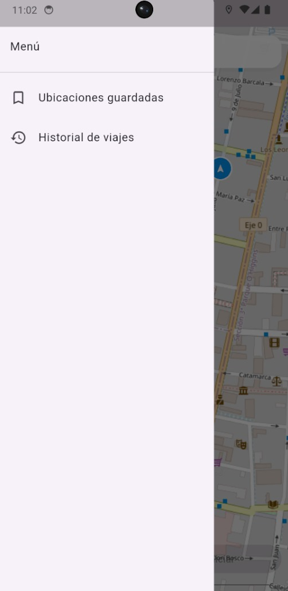

# ¿Cómo llego?

App de **reparto y recorridos con varias paradas** para Android, hecha en
**Flutter**. Marcás los puntos en el mapa (o los buscás por dirección), la app
calcula **el orden más rápido** para visitarlos y te guía parada por parada.
Si te desviás, recalcula la ruta.

Funciona con datos abiertos (OpenStreetMap, Nominatim y OSRM): sin API keys y
sin costo.


| Mapa y búsqueda | Ruta optimizada en navegación | Menú |
|---|---|---|
|  |  |  |

## Qué hace

- **Paradas en el mapa:** tocás el mapa para agregar un punto, o buscás una
  dirección. Desde «Configurar ruta» elegís el inicio y el final.
- **Orden óptimo de visita:** pide a OSRM la matriz de tiempos de manejo entre
  todos los puntos y resuelve el recorrido (ver abajo). Podés fijar cuál es la
  primera parada y cuál la última.
- **Navegación:** sigue tu GPS, muestra la distancia a la próxima parada y va
  recortando la línea a medida que avanzás. Con el botón **Llegué** pasás a la
  siguiente.
- **Recálculo:** si te alejás más de 60 m de la ruta, la vuelve a pedir.
- **Ubicaciones guardadas** e **historial de viajes**, persistidos en el
  teléfono.

## Cómo optimiza el recorrido

Es un caso del problema del viajante (TSP) con extremos fijos:

1. **Matriz de tiempos:** una sola llamada a `table/v1` de OSRM devuelve los
   segundos de manejo entre cada par de puntos, siguiendo las calles reales y
   no la línea recta.
2. **Vecino más cercano:** desde tu posición, va siempre a la parada pendiente
   más cercana en tiempo, respetando la primera y la última si las fijaste.
3. **Mejora 2-opt:** prueba invertir tramos del recorrido y se queda con el
   cambio si baja el tiempo total, hasta que ninguna inversión mejore.
4. Con el orden definido, pide la geometría a `route/v1` y la dibuja.

Para la cantidad de paradas de un reparto (de 5 a 30), esto da recorridos
muy cerca del óptimo en milisegundos y en el propio teléfono.

## Correrlo

Requiere el [SDK de Flutter](https://docs.flutter.dev/get-started/install) y
un dispositivo o emulador Android con GPS.

```bash
git clone https://github.com/Hutchy147/como-llego-
cd como-llego-
flutter pub get
flutter run
```

## Stack

| | |
|---|---|
| UI y mapa | Flutter, [`flutter_map`](https://pub.dev/packages/flutter_map) con teselas de OpenStreetMap |
| Ubicación | `geolocator` y `flutter_map_location_marker` |
| Búsqueda de direcciones | [Nominatim](https://nominatim.org/) |
| Rutas y matriz de tiempos | [OSRM](https://project-osrm.org/) (servidor público de demostración) |
| Persistencia | `shared_preferences` |

> El servidor público de OSRM y Nominatim son para demostraciones y tienen
> límite de uso. Para usarlo en serio conviene levantar una instancia propia
> de OSRM (con Docker) y cambiar las URLs en `lib/main.dart`.

## Pendientes

- Separar `lib/main.dart` (2400 líneas) en pantallas, servicios y modelos.
- Importar las paradas desde una planilla.
- Tests del optimizador de recorrido.
